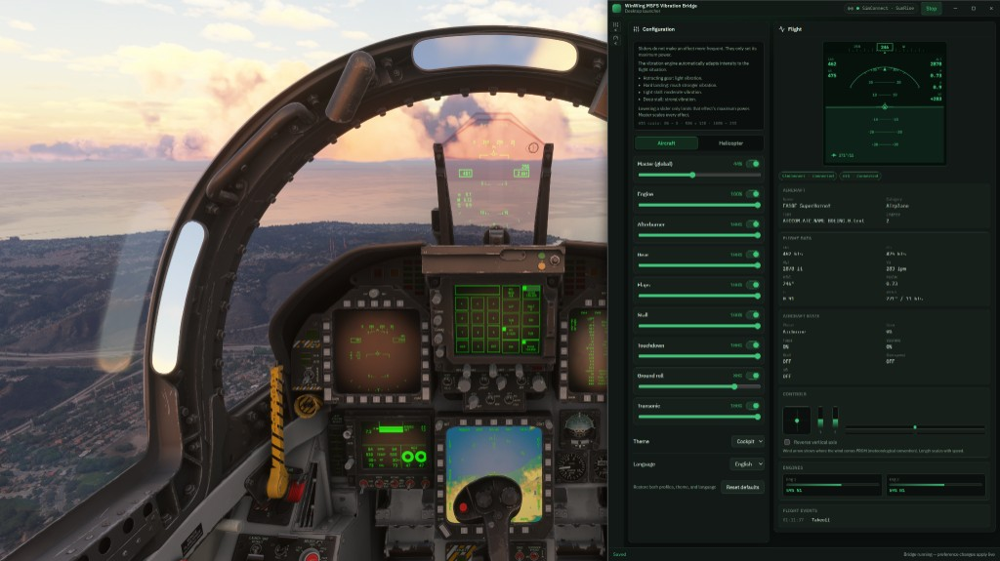
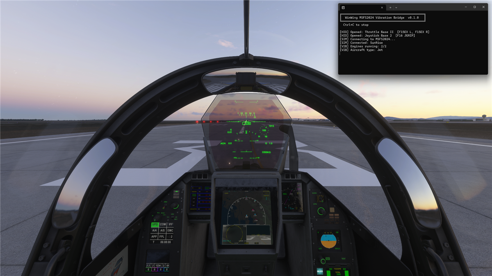

# WinWing MSFS Vibration Bridge

Unofficial Windows utility for driving vibration motors on supported WinWing Orion 2 controllers in Microsoft Flight Simulator using SimConnect telemetry.

**Compatibility**

This project is developed, tested and officially supported **only with Microsoft Flight Simulator 2024**.

It relies on real-time telemetry provided through **SimConnect**.

Other simulators, including previous Microsoft Flight Simulator versions, are **not supported** and compatibility should not be assumed.

> ## Aircraft Compatibility
>
> The bridge is **aircraft-agnostic**.
>
> It uses standard Microsoft Flight Simulator SimConnect variables rather than aircraft-specific integrations. This means vibration effects work with virtually any aircraft that correctly exposes SimConnect data, regardless of the developer.
>
> Whether you fly default aircraft or third-party add-ons, the bridge automatically adapts its effects based on the aircraft type (jet, piston, turboprop, or helicopter) and the available flight data.
>
> No aircraft-specific profiles or plugins are required.

Both interfaces share the exact same vibration core.
Choose the interface that best fits your workflow: the Desktop Launcher for configuration and live telemetry, or the lightweight Classic CLI for VR, diagnostics and scripting.

## Interfaces

### Desktop Launcher

The recommended interface for most users, with:

- live SimConnect telemetry;
- fighter-inspired HUD;
- Aircraft and Helicopter vibration profiles;
- local preferences;
- standalone Windows runtime with no Node.js required.

<p align="center">
  
</p>

### Classic CLI

The original lightweight console interface remains available for:

- minimal resource usage;
- VR sessions;
- diagnostics;
- scripting and direct console feedback.

<p align="center">
  
</p>

## CLI vs Desktop Launcher

| | CLI | Desktop launcher |
|--|-----|------------------|
| Role | Run the vibration bridge | Configure profiles / themes; Start/Stop shared bridge |
| Feel curves | Built-in defaults from the shared core | Editable Aircraft / Helicopter profiles (local only) |
| Preferences file | None | OS app data via Tauri Store (`launcher-preferences.json`) |
| SimConnect / HID | Active via shared `createBridge()` | Same runtime via packaged `bridge-host` sidecar (UI never talks to HID/SimConnect) |
| Runtime dependency | Node.js (source) or packaged CLI exe | None (sidecar embedded in the installer) |
| Best for | VR, minimal footprint, diagnostics | Desktop tuning with live HUD and telemetry |

Launcher preferences live under the Windows app data directory for identifier `community.winwing.msfs2024-vibration-bridge` (managed by Tauri / the Store plugin). They are **never** read by the CLI and are not stored in the git repository.

## Project status

- **March 23, 2026** — Initial private CLI prototype.
- **July 17, 2026** — Development resumed for a public release, introducing the Desktop Launcher and numerous improvements.
- Functional on the hardware listed below
- First public / community release (`v0.1.0`)
- Desktop Launcher and Classic CLI share the same vibration engine.
- **Not affiliated with, endorsed by, or supported by WinWing or Microsoft**
- Compatibility is limited to the devices and grips that were actually tested

## Tested hardware

| Item | Notes |
|------|--------|
| WinWing Orion 2 Throttle Base II | USB PID `0xBD64` |
| F-15EX throttle grips (left + right) | Vibration motors on each grip |
| WinWing Orion 2 Joystick Base 2 | USB PID `0xBEA8` |
| F-16 joystick grip | Vibration motor |
| Microsoft Flight Simulator 2024 | Windows |

Other WinWing PIDs, grips, or bases are **not** claimed to work.

## Install from a release

When a GitHub Release is published, download `WinwingVibration.exe`, connect the tested hardware, start MSFS 2024, then run the executable.

Windows Defender / SmartScreen may warn about an **unsigned community binary**. That is expected until a signed release exists. Prefer building from source if you want to verify the code yourself.

*(No release artifact is guaranteed to exist yet—check the repository Releases page.)*

## Usage

**Desktop launcher:** install the NSIS build (or run `npm run dev:launcher`), start MSFS 2024, then use **Start** in the title bar.

**Classic CLI:**

1. Connect the Throttle Base II and/or Joystick Base 2 with the tested grips.
2. Launch MSFS 2024 and load a flight.
3. Start the bridge (`npm start` or `WinwingVibration.exe`).
4. Keep the console window open while flying.
5. Press `Ctrl+C` for a clean shutdown (motors are zeroed before exit).

If hardware is plugged in later, the bridge periodically re-scans and opens newly available devices.

## How it works

1. SimConnect streams selected aircraft variables each simulation frame.
2. The bridge converts those values into haptic intensities (engine, aero, etc.).
3. Intensities are sent as short HID output reports to the open WinWing devices.
4. A ~50 Hz refresh loop keeps motors active (vibration stops if reports stop).

**SimAppPro is not required** while this bridge is running. Close or avoid exclusive locks from other tools if a device fails to open.

This program does not send flight data over the Internet. It only uses local SimConnect and local HID I/O (plus normal Node.js package installs when building from source).

## Current effects

Effects are a **haptic interpretation** of available SimVars, not certified flight fidelity.

**Intensity sliders (launcher)** map to the real HID motor byte:

| Slider | HID byte |
|--------|----------|
| 0% | 0 |
| 50% | ≈128 |
| 100% | 255 |

Each effect keeps its trigger conditions and 0..1 dynamic curve. The slider is that effect’s hardware ceiling. **Master** multiplies the summed contribution last, then the value is clamped to `0..255` (never 256).

```text
effectOutput = dynamicFactor × (effectSlider / 100) × 255
finalOutput  = clamp(sum(activeEffects) × (master / 100), 0, 255)
```

Effects include:

- Engine RPM per engine (piston / turboprop / jet)
- Afterburner per engine (where SimVars are present)
- Touchdown pulse (based on last airborne vertical speed, wall-clock decay)
- Landing gear transit and gear drag
- Stall buffet
- G-force buffet
- Transonic / supersonic buffet
- Speed brake
- Flap buffet
- Helicopter rotor rumble, ETL, and VRS cues
- Light APU vibration when engines are off

Aircraft that do not expose a given SimVar will simply not produce that effect.

## Install from source

**Requirements**

- Windows
- [Node.js](https://nodejs.org/) **20 or newer** (build uses `@yao-pkg/pkg` target `node22-win-x64`)
- MSFS 2024 installed (for SimConnect)
- Compatible WinWing hardware connected

```bash
npm ci
npm start
```

Build the CLI executable:

```bash
npm run build
# or explicitly:
npm run build:cli
```

Output: `dist/WinwingVibration.exe` (not committed to git). The packaged runtime is Node 22.

Build the launcher bridge-host sidecar (autonomous; no system Node.js at runtime):

```bash
npm run build:bridge-host
```

Output (not committed):

- `dist/sidecars/bridge-host-x86_64-pc-windows-msvc.exe`
- `apps/launcher/src-tauri/binaries/bridge-host-x86_64-pc-windows-msvc.exe`

Build the desktop launcher (NSIS, embeds the sidecar):

```bash
npm run build:launcher
```

Run unit tests (CLI core + host protocol + launcher preferences; no simulator / no hardware required):

```bash
npm test
```

## Launcher development

Requirements beyond the CLI: Rust toolchain, Windows WebView2 (usually preinstalled). The bridge host sidecar is built with `@yao-pkg/pkg` before Tauri starts.

```bash
npm --prefix apps/launcher ci
npm run build:bridge-host
npm run dev:launcher
```

`tauri dev` / `tauri build` also call `scripts/ensure-bridge-host.js` automatically so the sidecar exists under `apps/launcher/src-tauri/binaries/`.

Build the launcher NSIS installer (embeds the sidecar):

```bash
npm run build:launcher
```

Typecheck:

```bash
npm run typecheck:launcher
```

**Launcher highlights:** FR/EN i18n; Flight panel with sticky HUD and scrollable telemetry; resizable config/flight splitter; panel rail collapse; stick reverse option — see [docs/TELEMETRY.md](docs/TELEMETRY.md) and [docs/INTENSITY.md](docs/INTENSITY.md).

## Telemetry architecture

```text
MSFS → createBridge() → host stdout (≤15 Hz) → Tauri → launcher UI / HUD
                 ↘ 50 Hz HID vibration (unchanged)
```

- Without MSFS: launcher stays usable; SimConnect shows Disconnected / Connecting; HUD stays neutral.
- Without WinWing HID: telemetry and HUD still work; HID status is independent.
- Sidecar crash: last values marked stale; Start again after the host respawns.

Smoke-test the **packaged** sidecar (not `node lib/bridge/host.js`):

```bash
npm run build:bridge-host
npm run smoke:bridge-host
```

Requires MSFS 2024 in a flight for a full SimConnect pass (exit code `4` if the sim is offline).

## Planned features

The following are planned improvements only (not available yet):

- Silent bridge-host startup when launched from the Desktop Launcher.
- Optional Windows system tray support.
- Configurable launcher close behavior:
  - Exit application
  - Minimize to tray
- Tray menu:
  - Open
  - Start / Stop bridge
  - Exit

## Known limitations

- Windows only
- Only the listed USB PIDs / grip combinations are supported
- Desktop launcher is autonomous (bundled `bridge-host` sidecar); CLI from source still needs Node.js
- UI telemetry is capped at ~15 Hz; HUD interpolates locally (not a certified instrument)
- Control positions use SimConnect surface/lever positions (not raw USB HID axes)
- Release binaries are unsigned
- Effect quality depends on SimVars each aircraft publishes
- Third-party aircraft may omit or mishandle some variables
- Packaged sidecar uses EvenAR `node-simconnect` (pure JS over the SimConnect service); no `SimConnect.dll` is shipped

Experimental HID research scripts are not part of the public runtime and are not required to run the bridge.

## Safety and disclaimer

- Unofficial community software
- Not affiliated with, approved by, or supported by WinWing or Microsoft
- Use at your own risk; provided **without warranty** of any kind
- Stop the software immediately if vibration behaviour is unexpected or excessive
- **Never** use this software as a source of real-world flight information

## Credits

During the reverse engineering of WinWing Orion 2 vibration support, one issue remained unsolved: although valid HID vibration commands were being sent, the motors would not stay active reliably.

After many unsuccessful experiments, I studied the [Ursa Minor FFB](https://github.com/rtroncoso/ursa-minor-ffb) project by [rtroncoso](https://github.com/rtroncoso). While no code from that project was reused, it helped me understand the communication behavior required by WinWing devices, which ultimately led to the solution.

Once that missing piece was understood, the Orion 2 implementation worked as expected.

All Orion 2 support, vibration effects, SimConnect integration, Desktop Launcher, and application code were developed independently.

## Contributing

Bug reports and compatibility notes are welcome. Please include:

- Exact hardware (base + grip) and USB PID if known
- Aircraft title
- MSFS 2024 version / build if available
- Steps to reproduce
- Relevant console logs **without** personal paths or account data

Pull requests that change feel curves should explain the motivation; please keep the supported hardware scope clear.

## License

[MIT](./LICENSE) — Copyright (c) 2026 Apch132
